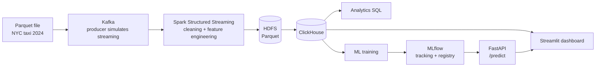

# NYC Taxi Big-Data Pipeline

End-to-end data engineering + ML project on NYC taxi trips (2024), fully containerised and started with **one command**.



## Stack

| Layer | Tool |
|---|---|
| Ingestion | Apache Kafka (KRaft) |
| Processing | Apache Spark 3.5 (Structured Streaming) |
| Storage | HDFS, ClickHouse |
| ML | scikit-learn, MLflow |
| Serving | FastAPI |
| Dashboard | Streamlit + Plotly |
| Deployment | Docker Compose, GitHub Actions (CI) |

## Quick start

Requirements: Docker Desktop (≥ 8 GB RAM recommended).

```bash
git clone https://github.com/<your-user>/nyc-taxi-pipeline.git
cd nyc-taxi-pipeline
docker compose up --build
```

The first run takes 15–30 minutes (image downloads). The dataset file is downloaded automatically into `data/`
(or put `fhvhv_tripdata_2024-01.parquet` there yourself). Services start in order:
Kafka → producer → Spark → ClickHouse load → model training → API → dashboard.

| What | URL |
|---|---|
| Dashboard | http://127.0.0.1:8501 |
| API docs (Swagger) | http://127.0.0.1:8000/docs |
| MLflow | http://127.0.0.1:5000 |
| HDFS UI | http://127.0.0.1:9870 |

### Configuration (`.env`)

Copy `.env.example` to `.env`. Two modes:

| Mode | Use for | How it works |
|---|---|---|
| `MODE=batch` `MONTHS=all` | the full year (12 files, ~4 GB) | Spark reads the Parquet files directly |
| `MODE=stream` `MONTHS=2024-01` `LIMIT=500000` | small samples / streaming demo | rows are published to Kafka, Spark Structured Streaming consumes them |

Full year needs roughly 12 GB RAM for Docker/WSL and 25+ GB of free disk.
Streaming the entire year through a single Python producer would take hours, hence the batch mode.
Tip: validate first with `MONTHS=2024-01,2024-02`.

### Day-to-day commands

```bash
docker compose start kafka namenode datanode clickhouse mlflow api dashboard   # resume without re-processing
docker compose stop                                                            # stop, keep data
docker compose down -v                                                         # wipe everything and start clean
```

## Model

Predicts **trip duration (minutes)** from pickup/dropoff zone, distance, hour and day of week
(`HistGradientBoostingRegressor`). On a 500k-trip sample: MAE ≈ 3.3 min, R² ≈ 0.81.

```bash
curl -X POST http://127.0.0.1:8000/predict -H "content-type: application/json" \
  -d '{"PULocationID":132,"DOLocationID":230,"trip_miles":12.5,"pickup_hour":18,"pickup_dow":6}'
```

## Project layout

```
producer/     Parquet -> Kafka
spark/        Kafka -> clean + features -> HDFS
clickhouse/   schema, HDFS load, analytics queries
ml/           training + MLflow logging
api/          FastAPI model service
dashboard/    Streamlit dashboard
.github/      CI workflow
```

## Notes

- Kafka is fed from a static file to simulate a stream (the dataset is batch data).
- Data source: NYC TLC trip records, mirrored at `huggingface.co/datasets/DinoPonjevic/NYC_TaxiData`.
